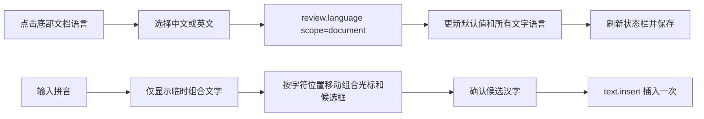

# 中文字体、文档语言与输入法

## 背景与规则

中文编辑需要同时处理字体、文档语言和输入法组合状态。这三者独立于左上角的界面语言：切换界面语言不改正文或文档格式。右键菜单的操作、表格子菜单和校对提示随界面语言切换；拼写建议、同义词及提示中的原文单词保持原样。

- 字体菜单固定提供 **宋体** 和 **黑体**。文档保留这两个名称；本机有对应字体时优先使用，否则宋体映射到 Noto Serif CJK SC，黑体映射到 Noto Sans CJK SC 等可用开放字体。
- 网页默认部署需提供这两个 Noto 字体：Noto Sans CJK SC 从项目资源默认编译到 WASM，Noto Serif CJK SC 从 `resources/fonts/server/` 通过 [服务端字体目录](web-fonts.md) 提供。`?local` 静态模式只使用编译内置字体，不加载服务器字体。
- 底部状态栏读取实际文字语言；点击后可将整个文档设为 **中文（中国）** 或 **English (United States)**。审阅 → 语言使用同一菜单。
- 整篇设置更新正文、表格、页眉页脚等 story、样式默认值及后续输入语言，保留文字、其他格式和选区，可撤销并随文档保存。
- 混合语言选区显示“多种语言”；界面保留导入文档的其他语言标签。语言设置是元数据，不翻译正文，也不增加新的中文语法检查器。
- DOCX 输出显式写入东亚字体和语言属性，避免其他软件只读取西文字体/语言。

## 交互流程



## 实现

`review.language` 原有选择范围语义保持不变；增加 `scope: "document"` 用于整篇文档，默认 `scope: "selection"`。
`format.state.lang` 返回当前选区的语言，混合时为 `null`，供状态栏和 agent 查询。

```json
{"command":"review.language","params":{"lang":"zh-CN","scope":"document"}}
```

字体替换集中在 `crates/fonts/src/word.rs`；项目资源只包含有来源和许可证的开放字体，不包含专有的宋体、黑体文件。
`crates/ui-egui/src/language.rs` 复用同一菜单，所有变更走命令注册表。

输入法的预编辑文字和字符光标位置存于 `CanvasState`，不改引擎文档；画布用实际字号及页面变换定位预编辑文字、可见光标和 `IMEOutput.cursor_rect`。
平台收到的候选框位置与可见组合光标一致；只有 Commit 事件调用 `text.insert`，清除预编辑状态。

## 验证

引擎测试覆盖文档语言更新、撤销、选区隔离、混合语言及非法参数；DOCX 往返测试覆盖中文字体和语言属性。
IME 回归测试通过真实 UI 事件验证组合光标、字符索引边界、字号、文档不变和一次提交。
浏览器验收覆盖中文/英文保存后刷新、宋体/黑体选择，以及 Chromium composition 事件下的候选框锚点。
