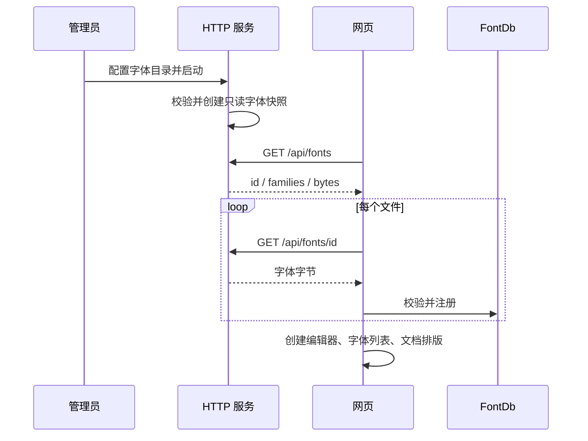

# 服务端字体扩展

## 背景和概念

网页不能读取访问者电脑中的系统字体。文档中文字的字形、换行、分页和 PDF 导出必须使用同一套字体数据。
现有 `FontDb` 负责字体解析和排版；HTTP 服务只分发管理员提供的文件，不增加字体数据库或独立服务。

- **内置字体**：随 WASM 编译的基础字体，包括提供 `CRAFT_FONTS_DIR` 时的 Noto Sans CJK SC Regular。
- **服务端字体**：`WORDCRAFT_FONTS_DIR` 中的 TTF、OTF、TTC 文件；启动时校验并读取内存。
- **字体族/样式**：读取字体文件内部名称，文件名不参与文档格式。相同字体族和样式优先保留内置/先加载版本；新增粗体等样式可以补充已有字体族。
- **字体 ID**：每次服务启动分配的 UUID，只用于下载；不是服务器路径，也不写入文档。服务重启后旧 ID 返回 404，避免混用新旧目录。

## 安装和扩展

字体保存在 WordCraft 仓库外，例如 `/srv/wordcraft-fonts`。仅放入有权分发的字体，并在该外部目录保留来源与许可证。
推荐使用 Noto CJK 的开放字体；不要复制商业办公软件内附字体。

```sh
# 目录可以按字体族分子目录，并保留 OFL.txt 等许可证。
WORDCRAFT_FONTS_DIR=/srv/wordcraft-fonts cargo run -p wordcraft-server
```

目录示例：

```text
/srv/wordcraft-fonts/
  noto-serif-cjk-sc/
    NotoSerifCJKsc-Regular.otf
    OFL.txt
```

Noto Serif CJK SC 来自 [Noto CJK 官方仓库](https://github.com/notofonts/noto-cjk/tree/main/Serif/OTF/SimplifiedChinese)，
许可证见 [Serif/LICENSE](https://github.com/notofonts/noto-cjk/blob/main/Serif/LICENSE)。
客户端不需要安装字体。增加/删除/替换文件后重启服务，然后保存当前编辑并刷新网页；无需重编译 WASM。
只有可解析的字体文件会发布，其他文件不会通过字体 API 暴露。配置错误、无效字体或超过限制会使服务启动失败并输出原因。

## 加载流程与规则



- 接受扩展名 TTF/OTF/TTC（不区分大小写）；目录最多四层、1024 个条目、64 个字体文件。跳过符号链接。
- 单文件最多 40 MiB，全部字体最多 128 MiB。字体集合解析最多 64 个 face，每个 face 最多 256 个命名实例。
- 浏览器在创建编辑器前顺序加载字体，整个网络加载限时 30 秒；失败时保留已加载及内置字体，界面显示可见提示。保存后刷新可重试。
- 字体列表、字形渲染、分页和 PDF 导出共用 `FontDb`；不修改文档内容或 dirty 状态。
- DOCX 保存的是字体族名称，显式写入 `w:eastAsia` 等字体属性，不内嵌服务端字体；其他软件或其他部署缺少字体时可能出现不同排版。
  东亚字体属性依据 [公开 Open XML 文档](https://learn.microsoft.com/en-us/dotnet/api/documentformat.openxml.wordprocessing.runfonts.eastasia)。
- `?local` 静态模式仅使用编译内置字体，不访问服务端字体 API。
- 初版按页面启动加载整个受限目录，不支持热替换、浏览器上传字体或实时推送。字体总量应保持精简。

## 实现与验证

`crates/remote::FontFile` 是共享协议；`apps/wordcraft-server/src/fonts.rs` 封装目录读取、限制和分发；
`apps/wordcraft-web/src/fonts.rs` 负责异步下载和启动前注册。底层字体模块不依赖 HTTP 或 UI。

```sh
cargo test -p wordcraft-server -p wordcraft-fonts
cargo xtask ci
```

测试覆盖字体列表与原始字节、重启后旧 ID 失效、无效字体、大小/数量限制、符号链接隔离和跨站拒绝。
实际验收应选中中文正文 → 切换服务端字体 → 保存 → 刷新 → 确认字体名称、正文及排版保留。
