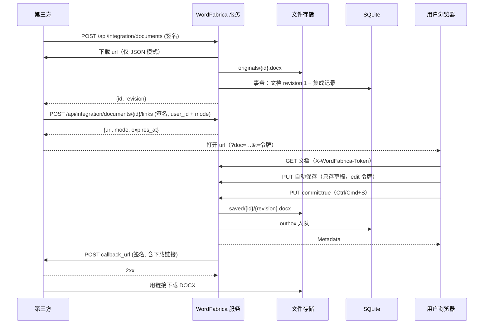

# 第三方集成（WEB.4）

## 背景和边界

第三方系统把 DOCX 交给 WordFabrica，用户在浏览器里编辑，每次显式保存都会导出 DOCX 并回调第三方。
思路与 [ONLYOFFICE 的保存回调](https://api.onlyoffice.com/docs/docs-api/get-started/how-it-works/saving-file) 相同，
但仍是同一个 Rust 进程：回调队列在 SQLite 中，文件在本地目录或 MinIO，不需要独立转换或消息服务。
基础编辑器和存储见 [web-storage.md](web-storage.md)。

- 不启用时（未设置 `WORDFABRICA_INTEGRATION_SECRET`）所有 `/api/integration/*` 路由返回 404，行为与之前完全一致。
- 第三方文档按用户授权：第三方为每个用户申请一条访问链接（编辑或只读），服务器校验链接里的签名令牌，见[访问链接](#访问链接)。
- WordFabrica 本身没有账号。链接发出后不能撤销，只能等它过期（请用较短的 `ttl`）。编辑器自己的文档（非第三方）没有按用户的权限，信任模型与基础编辑器相同，共享部署请放在带身份认证的反向代理之后。
- 只处理 DOCX。`.docm` 保存后丢失宏，`.dotx` 保存后成为普通文档。没有版本历史界面。

## 流程

1. 第三方 `POST /api/integration/documents`，给出 DOCX（服务器下载 URL，或 multipart 上传）、`callback_url` 和自己的 `key`。
2. 服务器用 `wordfabrica_docx` 解析；原件存为 `originals/{id}.docx`；同一个 SQLite 事务里创建 revision 1 的编辑器文档和集成记录。
3. 返回 `{id, revision}`，不再返回编辑链接。
4. 用户每次要打开文档时，第三方（它管用户系统，决定谁能编辑、谁只能看）调用 `POST /api/integration/documents/{id}/links`，给出 `user_id`、`mode`（`edit` 或 `view`），得到 `{url, mode, expires_at}`。`url` 为 `{WORDFABRICA_PUBLIC_URL}/?doc={id}&t={token}`，把它交给用户在浏览器（或 iframe）里打开。
5. 浏览器读出 `t`，每个请求都带上；服务器校验令牌。只读链接打开的文档不可编辑也不保存。
6. 自动保存只写 JSON 草稿，不产生回调。
7. 用户显式保存（Ctrl/Cmd+S 或保存按钮）时，请求带 `commit: true`：服务器导出 DOCX，存为 `saved/{id}/{revision}.docx`，在 SQLite outbox 排队，后台 worker 向 `callback_url` 发送签名回调，回调里带保存者的 `user_id` 和 `user_name`。



`commit` 的处理幂等：导出或存储失败时用户看到 503，重试同一份快照会被确认并再次提交。没有集成记录的普通文档忽略 `commit`。

## 配置

| 环境变量 | 默认值 | 职责 |
|---|---|---|
| `WORDFABRICA_INTEGRATION_SECRET` | 未设置 = 关闭 | 与第三方共享的密钥，至少 32 字节 |
| `WORDFABRICA_PUBLIC_URL` | 无 | 启用时必填。用户和第三方访问本服务的地址，如 `https://docs.example.com`，用于访问链接和下载链接 |
| `WORDFABRICA_STORAGE` | `local` | `local` 或 `minio` |
| `WORDFABRICA_STORAGE_DIR` | `<数据目录>/files` | `local` 时的文件目录 |
| `WORDFABRICA_S3_ENDPOINT` | 无 | `minio` 必填，如 `http://127.0.0.1:9000` |
| `WORDFABRICA_S3_BUCKET` | 无 | `minio` 必填；桶必须事先存在 |
| `WORDFABRICA_S3_ACCESS_KEY` / `WORDFABRICA_S3_SECRET_KEY` | 无 | `minio` 必填 |
| `WORDFABRICA_S3_REGION` | `us-east-1` | S3 区域 |
| `WORDFABRICA_DOWNLOAD_TTL` | `3600` | 下载链接有效秒数，范围 60..=604800 |
| `WORDFABRICA_ALLOW_HOSTS` | 空 = 不限制 | 逗号分隔的主机名；同时约束文档 URL（含每次重定向）和 `callback_url`。生产环境建议设置，防止 SSRF |

配置错误（密钥过短、缺少必填项、TTL 越界）时服务拒绝启动。MinIO 使用 path-style 地址，允许 `http://`。

本地 MinIO 示例：

```sh
docker run -p 9000:9000 -p 9001:9001 \
  -e MINIO_ROOT_USER=minio -e MINIO_ROOT_PASSWORD=minio12345 \
  minio/minio server /data --console-address :9001
mc alias set local http://127.0.0.1:9000 minio minio12345
mc mb local/wordfabrica

export WORDFABRICA_INTEGRATION_SECRET="$(openssl rand -hex 32)"
export WORDFABRICA_PUBLIC_URL=http://127.0.0.1:8771
export WORDFABRICA_STORAGE=minio
export WORDFABRICA_S3_ENDPOINT=http://127.0.0.1:9000
export WORDFABRICA_S3_BUCKET=wordfabrica
export WORDFABRICA_S3_ACCESS_KEY=minio
export WORDFABRICA_S3_SECRET_KEY=minio12345
cargo run -p wordfabrica-server
```

MinIO 模式下下载链接是 S3 预签名 URL；本地模式下是服务器自己签名的 `/api/integration/files/...` 链接。

## 请求签名

第三方发给 WordFabrica 的每个 `/api/integration/documents*` 请求带两个头：

- `X-WordFabrica-Timestamp`：Unix 秒，与服务器时间相差不超过 ±300 秒。
- `X-WordFabrica-Signature`：小写十六进制 `HMAC-SHA256(secret, "{timestamp}.{METHOD}.{path}.{raw body bytes}")`。

`path` 是 WordFabrica 收到的 URL 路径，不含查询串（反向代理若改写路径，要按改写后的路径签名）。
`METHOD` 为大写。`GET` 没有请求体，签名串以 `.` 结尾。`body` 必须与实际发送的字节完全一致。

### curl（JSON 模式）

```sh
SECRET=...                       # 与服务器相同
BASE=http://127.0.0.1:8771
P=/api/integration/documents
BODY='{"url":"https://files.example.com/a.docx","file_name":"a.docx","callback_url":"https://app.example.com/wordfabrica/callback","key":"doc-42"}'
TS=$(date +%s)
SIG=$(printf '%s.POST.%s.%s' "$TS" "$P" "$BODY" | openssl dgst -sha256 -hmac "$SECRET" -hex | awk '{print $NF}')
curl -sS "$BASE$P" -H 'Content-Type: application/json' \
  -H "X-WordFabrica-Timestamp: $TS" -H "X-WordFabrica-Signature: $SIG" \
  --data-binary "$BODY"
# {"id":"…","revision":1}

# 为用户 u-7 申请一条编辑链接（POST，签名方式相同；换成 "mode":"view" 即只读）
ID=...
P=/api/integration/documents/$ID/links
BODY='{"user_id":"u-7","user_name":"Alice","mode":"edit","ttl":3600}'
TS=$(date +%s)
SIG=$(printf '%s.POST.%s.%s' "$TS" "$P" "$BODY" | openssl dgst -sha256 -hmac "$SECRET" -hex | awk '{print $NF}')
curl -sS "$BASE$P" -H 'Content-Type: application/json' \
  -H "X-WordFabrica-Timestamp: $TS" -H "X-WordFabrica-Signature: $SIG" \
  --data-binary "$BODY"
# {"url":"http://127.0.0.1:8771/?doc=…&t=…","mode":"edit","expires_at":1760003600}

# 查询状态（GET，空请求体）
ID=...
P=/api/integration/documents/$ID
TS=$(date +%s)
SIG=$(printf '%s.GET.%s.' "$TS" "$P" | openssl dgst -sha256 -hmac "$SECRET" -hex | awk '{print $NF}')
curl -sS "$BASE$P" -H "X-WordFabrica-Timestamp: $TS" -H "X-WordFabrica-Signature: $SIG"
```

### Python（multipart 上传）

multipart 的边界和各部分头都属于请求体，所以先自己拼好字节，再对这些字节签名并原样发送。

```python
import hashlib, hmac, json, time, urllib.request

SECRET, BASE = b"...", "http://127.0.0.1:8771"
PATH = "/api/integration/documents"
meta = {"file_name": "a.docx", "callback_url": "https://app.example.com/wordfabrica/callback", "key": "doc-42"}
boundary = "wc-boundary-7f3a9"
body = b"".join([
    f'--{boundary}\r\nContent-Disposition: form-data; name="meta"\r\n'
    f'Content-Type: application/json\r\n\r\n{json.dumps(meta)}\r\n'.encode(),
    f'--{boundary}\r\nContent-Disposition: form-data; name="file"; filename="a.docx"\r\n'
    f'Content-Type: application/octet-stream\r\n\r\n'.encode(),
    open("a.docx", "rb").read(),
    f"\r\n--{boundary}--\r\n".encode(),
])
ts = str(int(time.time()))
sig = hmac.new(SECRET, ts.encode() + b".POST." + PATH.encode() + b"." + body, hashlib.sha256).hexdigest()
request = urllib.request.Request(BASE + PATH, data=body, method="POST", headers={
    "Content-Type": f"multipart/form-data; boundary={boundary}",
    "X-WordFabrica-Timestamp": ts,
    "X-WordFabrica-Signature": sig,
})
print(urllib.request.urlopen(request).read().decode())
```

## 接口

| 请求 | 说明 |
|---|---|
| `POST /api/integration/documents` | 签名。注册文档，返回 `{id, revision}` |
| `POST /api/integration/documents/{id}/links` | 签名。为一个用户签发访问链接，返回 `{url, mode, expires_at}` |
| `GET /api/integration/documents/{id}` | 签名。返回 `{id, key, revision, saved_revision, callback_state, url, url_expires_at}` |
| `GET /api/integration/files/{id}/{revision}?expires=&sig=` | 本地存储的下载链接，由服务器签名并过期；无需请求签名 |

创建请求有两种形式：

- `application/json`：`{url, file_name, callback_url, key, title?}`，服务器下载 `url`。
- `multipart/form-data`：`meta` 部分是同样的 JSON（不含 `url`），`file` 部分是 DOCX 字节。

| 字段 | 规则 |
|---|---|
| `file_name` | 1–255 字符，不含斜杠和控制字符；扩展名只能是 `.docx`、`.docm`、`.dotx`。保存结果始终是 DOCX，文件名为 `<stem>.docx` |
| `key` | 1–200 字符，第三方自己的文档标识，原样出现在回调里 |
| `title` | 可选，最多 200 字符；缺省为文件名主干 |
| `callback_url` | http(s)；配置了 `WORDFABRICA_ALLOW_HOSTS` 时主机必须在名单内 |
| `url` | 仅 JSON 模式。仅 http/https；15 秒超时；最多 5 次重定向且每一跳都按允许名单检查；最多 16 MiB |

请求体最大 16 MiB。状态里的 `callback_state` 为 `pending`、`done` 或 `failed`；还没有显式保存过时 `saved_revision`、`callback_state`、`url` 为 `null`。
每次查询状态都会生成新的下载链接。下载链接也允许从其他网站通过顶层导航打开（浏览器地址栏跳转），其余 API 仍然只限同源。

| 状态码 | 含义 |
|---|---|
| 400 | 输入无效，正文为 `{"error": "..."}` |
| 401 | 签名缺失、错误或时间戳过期；或访问令牌缺失、伪造、过期、属于别的文档 |
| 403 | 下载链接错误或已过期；或用只读令牌写文档 |
| 404 | 文档不存在（含申请链接时），或集成未启用 |
| 413 | 超过 16 MiB |
| 502 | 无法下载 `url` |
| 503 | 文件存储或导出失败 |

## 访问链接

`POST /api/integration/documents/{id}/links`（签名方式同上），JSON 请求体：

| 字段 | 规则 |
|---|---|
| `user_id` | 1–200 字符，第三方自己的用户标识 |
| `user_name` | 可选，最多 200 字符；缺省为 `user_id`。用于回调 |
| `mode` | `edit` 或 `view` |
| `ttl` | 可选，秒，范围 60..=604800，缺省 43200（12 小时） |

返回 `{url, mode, expires_at}`（`expires_at` 为 Unix 秒）。文档不存在返回 404，输入无效返回 400。
第三方每次有用户要打开文档时都申请一条新链接，把 `url` 原样交给用户。

令牌是 `base64url(JSON {doc, user_id, user_name, mode, exp}).hex(HMAC-SHA256(secret, "link." + base64url 部分))`。
它对第三方是不透明的，不需要解析。服务器在**每个请求**上校验它，所以 `ttl` 也是已打开的编辑器还能用多久：
过期后保存返回 401，用户要从第三方应用重新打开；页面里未保存的修改还在，可以先下载一份副本。

浏览器一侧：

- 编辑器从地址里读出 `t`，按文档存在 sessionStorage（同一标签页刷新仍可用），并从地址栏移除它。
- 对 `GET`/`PUT /api/documents/{id}` 带 `X-WordFabrica-Token` 头。不用 cookie，所以能在第三方网站的 iframe 里工作。
- 所有响应带 `Referrer-Policy: same-origin`，令牌不会作为 referrer 发给别的网站。

服务器一侧（只对第三方文档；编辑器自己的文档不变，不需要令牌）：

- 没有令牌、伪造、过期或属于别的文档：401。
- 用 `view` 令牌 `PUT`：403。
- `GET /api/documents/{id}` 对 `view` 链接返回 `read_only: true`。
- `GET /api/documents` 不列出第三方文档，它们只能通过访问链接打开。

只读模式（`Session.read_only`）由宿主设置，不存进文档，用户无法解除（不同于 Word 的“限制编辑”）。
所有会修改文档的命令都被拒绝，功能区里显示为灰色；不自动保存，也不能保存；状态栏显示“只读 / Read only”。

## 保存回调

服务器向 `callback_url` 发送 `POST`，`Content-Type: application/json`，带同样的两个头。
签名是 `HMAC-SHA256(secret, "{timestamp}.{raw body}")`，没有 METHOD 和 path。

```json
{"event":"document.saved","id":"…","key":"doc-42","revision":3,"title":"a","file_name":"a.docx",
 "url":"https://docs.example.com/api/integration/files/…","url_expires_at":1760000000,"saved_at":1759996400000,
 "user_id":"u-7","user_name":"Alice"}
```

`saved_at` 是 Unix 毫秒，`url_expires_at` 是 Unix 秒。`user_id`、`user_name` 是做这次显式保存的用户（来自其访问链接）。第三方用 `url` 下载 DOCX（链接过期前有效）。

验证示例（Python）：

```python
def verify(secret: bytes, headers, raw_body: bytes) -> bool:
    ts = headers["X-WordFabrica-Timestamp"]
    if abs(time.time() - int(ts)) > 300:
        return False
    expected = hmac.new(secret, ts.encode() + b"." + raw_body, hashlib.sha256).hexdigest()
    return hmac.compare_digest(expected, headers["X-WordFabrica-Signature"])
```

投递规则：

- 任何 2xx 都算送达。不跟随重定向，签名正文只会发到登记的地址；每次发送前会重新检查 `WORDFABRICA_ALLOW_HOSTS`。
- 失败后指数退避重试：`5 秒 × 2^(n-1)`，上限 1 小时，最多 10 次，之后状态为 `failed`。
- 同一文档较新的保存会取代较旧、未送达的回调；第三方应比较 `revision`，只接受不小于已处理版本的回调，并容忍重复。
- 队列在 SQLite 中，服务重启后继续投递。每次尝试都会生成新的下载链接。

## 实现

- `apps/wordfabrica-server/src/integration.rs`：配置、路由、请求签名中间件、创建/状态/下载。
- `apps/wordfabrica-server/src/links.rs`：访问令牌的签发与校验。
- `apps/wordfabrica-server/src/callbacks.rs`：outbox worker、退避、签名回调。
- `apps/wordfabrica-server/src/signing.rs`：HMAC-SHA256 签名与常量时间校验。
- `apps/wordfabrica-server/src/storage.rs`：本地目录或 MinIO（`object_store`）文件存储。
- `apps/wordfabrica-server/src/store.rs`：集成记录和 outbox 表。
- `crates/remote`：`WriteRequest.commit`（可选布尔，默认 `false`）。
- `apps/wordfabrica-web/src/remote.rs`：手动保存带 `commit: true`，自动保存不带；读取并携带访问令牌。
- `crates/engine/src/session.rs`：`Session.read_only` 和 `disabled()`。
