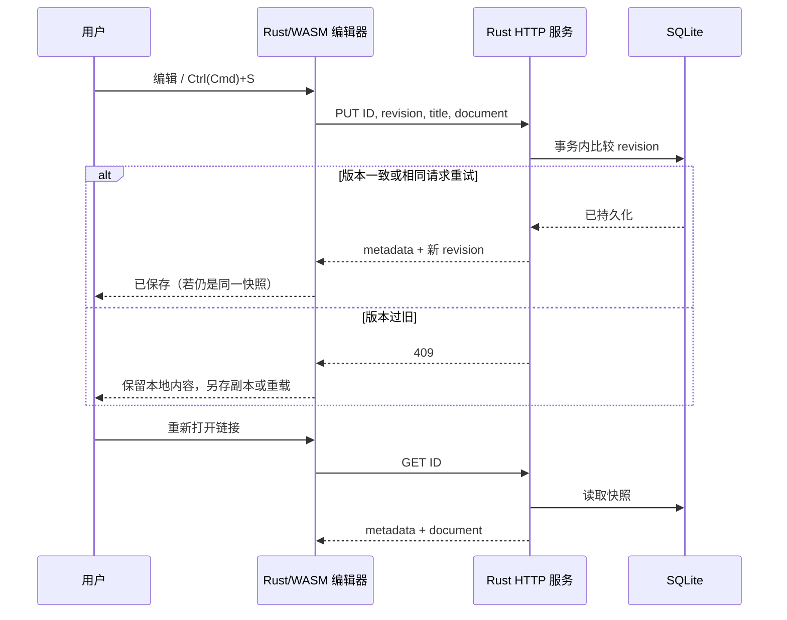

# 网页编辑与服务端保存

## 背景和边界

浏览器复用现有 Rust/WASM 编辑器、命令注册表和文档模型，保存从“下载文件”扩展为持久化服务端文档。
借鉴 [ONLYOFFICE 的编辑/存储边界](https://api.onlyoffice.com/docs/docs-api/get-started/how-it-works/saving-file)，
这里使用单个 Rust HTTP 进程直接提交文档快照，不引入独立转换服务、回调服务、消息队列或外部数据库。

初版面向本机或可信工作区；没有账号、租户隔离、实时合并、协作者光标或历史版本界面。
默认只监听 loopback；共享部署应由反向代理提供 HTTPS 和身份认证，且所有获准访问者共享同一文档库。

## 运行

需要 Rust 1.90+、`wasm32-unknown-unknown` 目标和 Trunk。使用 rustup 安装的 cargo/rustc，避免与系统工具链混用。

```sh
rustup target add wasm32-unknown-unknown
cargo install trunk --locked
# 默认使用项目 resources/fonts/，无需额外字体项目或环境变量。
cd apps/wordcraft-web
trunk build --release
cd ../..
cargo run -p wordcraft-server
```

打开 `http://127.0.0.1:8771/`。构建产物在 `dist/web`；服务器缺少构建产物时拒绝启动并提示构建命令。

| 环境变量 | 默认值 | 职责 |
|---|---|---|
| `WORDCRAFT_LISTEN` | `127.0.0.1:8771` | 监听地址 |
| `WORDCRAFT_WEB_DIR` | `dist/web` | 静态网页目录 |
| `WORDCRAFT_DATA_DIR` | `data` | SQLite 数据目录，不能放进静态网页目录 |
| `WORDCRAFT_FONTS_DIR` | `resources/fonts/server` | 可选的服务端字体目录；见 [字体扩展](web-fonts.md) |

路径相对启动目录。备份时停止服务再复制数据目录，或使用 SQLite backup API 在线备份；运行中不要只复制主数据库而忽略 WAL。
静态部署可用 `?local` 保留下载模式；`?sample` 创建演示内容；`?doc=<uuid>` 重新打开服务端文档。
开发时可直接重新执行 `trunk build` 并由同一服务提供资源，避免跨域配置。

## 概念与规则

- **Document**：现有完整模型，包含文字、格式、表格、图片、批注等。内部保存 JSON 快照，避免反复 DOCX 转换导致信息损失；浏览器仍可导出 DOCX/PDF。
- **ID**：浏览器生成的 UUID，不使用文件名/用户路径寻址。同一页面保存重试保持相同 ID。
- **Revision**：服务器版本，从 1 起。请求 0 表示创建；更新必须携带读取时的版本。
- **Local revision / epoch**：分别区分输入后内容变化与打开/新建后的文档身份。异步成功仅清除同一快照的 dirty 标志。
- 停止输入约 1.5 秒自动保存；持续输入时最多约 10 秒提交一次。只有一个保存请求在途。
- SQLite `BEGIN IMMEDIATE` + WAL + `synchronous=FULL` 原子提交；成功响应在事务提交之后。多个进程共享数据库也不能绕过版本比较。
- 旧版本返回 409，保留本地编辑；允许保存为新副本或确认放弃后重载。重复提交已提交的完全相同快照返回同一版本，处理成功响应丢失。
- 网络/HTTP 失败不会清除 dirty，也不会循环重试；用户重试或下载副本。请求与响应读取的总超时为 15 秒。
- 切换/新建/导入前要求当前编辑已保存；未保存或正在保存时，离开页面触发浏览器原生提醒（浏览器决定是否显示）。没有离线持久化草稿。
- 单次请求最大 16 MiB，标题为非空、最多 200 字符且无控制字符。JSON 解码有深度限制；使用固定 SQL 与绑定参数。



## API 和实现

| 请求 | 返回 |
|---|---|
| `GET /api/fonts` | 字体文件元数据列表 `{id,families,bytes}[]` |
| `GET /api/fonts/{id}` | 已校验的原始 TTF/OTF/TTC 字节；无效 ID 返回 404 |
| `GET /api/health` | `{"status":"ok"}` |
| `GET /api/documents` | 按修改时间降序的 `Metadata[]` |
| `GET /api/documents/{id}` | `{metadata, document}`，不存在时 404 |
| `PUT /api/documents/{id}` | 输入 `{revision,title,document}`，返回 `Metadata`；版本冲突 409 |

`Metadata` 为 `{id,title,revision,updated_at}`，时间是 Unix 毫秒。API 也供脚本/agent 使用；编辑操作仍通过引擎命令。
不启用 CORS；拒绝跨站 Fetch 和不匹配 Host 的 Origin；响应禁止缓存。

- `crates/remote`：L2 的共享线协议 DTO，仅依赖模型与 serde；避免前后端重复维护协议，不包含 HTTP 或存储实现。
- `apps/wordcraft-server`：交付层 HTTP 路由、配置和 SQLite 基础设施；阻塞操作移到 Tokio blocking 线程。
- `apps/wordcraft-web/src/remote.rs`：浏览器异步保存、文档列表和状态反馈；`sync.rs` 包含可在原生测试的回执规则。
- `Services::request_save`：让现有 `file.save` 菜单/快捷键/按钮走同一路径；导出保持独立，不将导出误认为服务端保存成功。

## 检查

```sh
cargo test -p wordcraft-server -p wordcraft-web -p wordcraft-ui-egui
cargo xtask ci
cargo check --target wasm32-unknown-unknown -p wordcraft-web
```

HTTP 测试覆盖创建/读取/列表/重试/冲突/非法 JSON/体积限制/跨域；存储测试覆盖重启与竞争写入。
浏览器验收：实际输入和格式化 → 已保存 → 刷新恢复 → 第二窗口冲突 → 保存副本；断网后保留编辑并可重试。

## 中英文界面

网页工具栏提供简体中文 / English 切换，沿用 `ui.language` 命令和 `i18n/*.tsv` 翻译目录。
首次按浏览器语言选择（中文语言标签使用简体中文，其他语言回退英文），以后优先使用当前站点 localStorage 中的显式选择。
切换即时更新菜单、保存状态、列表和错误文案，同时设置 HTML `lang`；不修改正文、格式、undo 历史或保存版本。
浏览器禁止存储时仍可切换，并显示偏好未保存的提示。网页端仅开放中英文；桌面端已有其他语言不受影响。

中文字形通过项目资源中的 Noto Sans CJK SC Regular (OFL-1.1) 默认嵌入 WASM，离线加载也可显示。字体资源用独立 `fonts-v*` tag 标记，无需额外项目。
只有使用自定义资源时才需要设置 `CRAFT_FONTS_DIR`，其中应包含中文字体；不需要客户端安装字体。
`crates/fonts/build.rs` 同时为中文 UI 和文档正文保留该字体，发布工作流已固定到包含它的字体版本。
